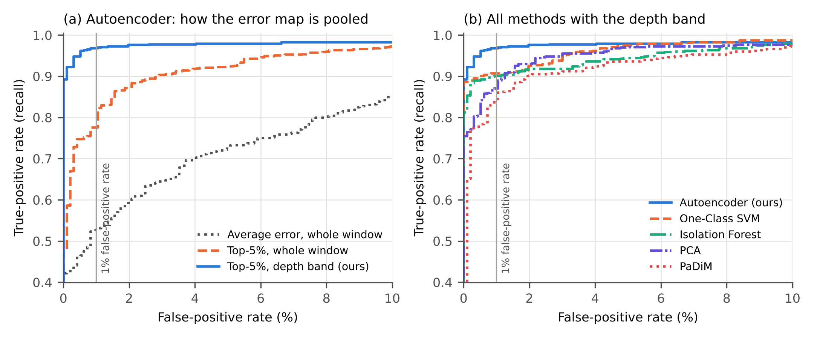
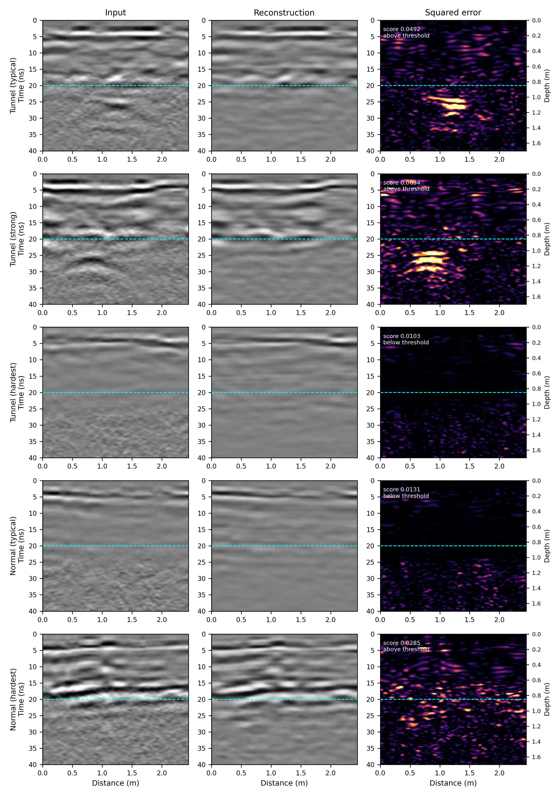

# Unsupervised Detection of Underground Tunnels in Ground-Penetrating Radar Using Depth-Restricted Reconstruction Scoring

Muhammad Junaid, Shoab A. Khan, Nisar Ahmed

> Paper: [arXiv:2607.04882](https://arxiv.org/abs/2607.04882)
> Dataset: [Kaggle: GPR Normal and Tunnel Anomaly Dataset (version 4 or later)](https://www.kaggle.com/datasets/muhammadjunaid007/gpr-normal-and-tunnel-anomaly-dataset)
> Trained model: [`gpr_best_model.pt`](../../releases) on the Releases page

Hand-dug tunnels beneath pipelines and protected sites are hard to find before they are used. This repository detects them in ground-penetrating radar (GPR) data **without any tunnel examples for training**. A convolutional autoencoder learns what the normal ground of a site looks like from surveys recorded before a tunnel exists. Later surveys are flagged where the autoencoder fails to reconstruct them.

The key element is **depth-restricted scoring**: the score pools the largest reconstruction errors only within the travel-time band in which a tunnel can occur. It leaves out the near-surface returns, which change most with soil moisture.

---

## Results

The test set has 1,600 windows (966 normal, 634 tunnel) from 55 survey lines across one hand-dug tunnel. Each survey line is judged by a threshold set only from the *other* lines (leave-one-line-out). The 95% confidence intervals come from resampling whole survey lines.

| Detector (depth band) | AUC [95% CI] | F1 [95% CI] | Missed tunnel windows | False positives | Tunnel crossings found | Recall at 1% false-positive rate |
|---|---|---|---|---|---|---|
| **Autoencoder (ours)** | **0.9936** [0.987, 0.999] | **0.972** [0.933, 0.993] | **18** | 18 | **29/29** | **0.968** |
| One-Class SVM (standardised) | 0.9930 [0.986, 0.998] | 0.939 [0.888, 0.971] | 68 | 5 | 27/29 | 0.907 |
| Isolation Forest | 0.9904 [0.981, 0.997] | 0.936 [0.883, 0.971] | 57 | 22 | 29/29 | 0.901 |
| PCA | 0.9897 [0.982, 0.996] | 0.930 [0.884, 0.962] | 73 | 11 | 29/29 | 0.879 |
| PaDiM | 0.9887 [0.981, 0.995] | 0.925 [0.865, 0.963] | 75 | 16 | 27/29 | 0.852 |
| PatchCore | 0.9259 [0.879, 0.963] | 0.624 [0.449, 0.760] | 345 | 4 | 17/29 | 0.546 |

- **The depth band improves every detector.** For the autoencoder, AUC goes from 0.986 (whole window) to 0.994. For PatchCore it goes from 0.768 to 0.926.
- **Every missed tunnel window lies at the edge of a crossing.** All 29 crossings are flagged.
- **Less data is enough.** With 25% of the training data, depth-band scoring (F1 0.945) beats whole-window scoring trained on all of it (F1 0.927).
- **The learned model is needed.** The best simple score of the same depth band without any learning (difference from the average window; brightness, contrast and edges do worse) misses 9 of the 29 crossings; the autoencoder misses none.
- **Why it works.** Normal-ground scores shift survey by survey (63-79% of their variance lies between survey lines), so the threshold is set from current clean lines; the depth band raises the separation of tunnel windows from 3.0 to 5.1 standard deviations.
- **The method is stable.** Across three training seeds: AUC 0.9937 ± 0.0003 and F1 0.9717 ± 0.0008, with all 29 crossings found by each model.

**Unseen ground.** These sites were never used for training, and the threshold comes from Site A:

| | Site C (5,545 windows) | Site B, irrigated soil (5,313 windows) |
|---|---|---|
| False alarms | 1.6% | 9.3% |

On the irrigated plot, resetting the threshold from one fifth of its survey lines lowers false alarms to 4.2%; retraining the autoencoder on that plot's own ground gives 3.6%, which is not a significant further gain (tested over all 136 lines in five rounds). So the model is trained once, and a new site needs only a short baseline survey to set the threshold. Models trained only on Site B's ground, never shown a Site A window, still detect the Site A tunnel (AUC 0.988 on average; F1 0.940 with the threshold set from clean Site A lines).

<p align="center"><br><em>ROC curves at low false-positive rates.</em></p>
<p align="center"><br><em>Windows, reconstructions and error maps; the dashed line marks the start of the depth band.</em></p>

---

## Field data

- **Site and time:** agricultural land near Islamabad, Pakistan, January–March 2025.
- **Instrument:** Sensors & Software LMX200 with a 250 MHz antenna, with traces every 0.05 m. Hyperbola fitting gives a propagation velocity of about 0.085 m/ns.
- **Tunnel:** hand-dug from a vertical entry shaft, leaving the ground surface above undisturbed.
  - Roughly arched; about 0.6 m wide and 1 m high.
  - More than 4.6 m long; air-filled and unlined.
  - Roof about 0.9–1.4 m below the surface.
- **Site A:** the same strips of ground were surveyed many times, before and after the tunnel was dug, in dry and wet conditions, by day and by night.
- **Sites B and C:** normal ground only, used to test false alarms on new ground. Site B had been irrigated for a separate soil-moisture study.
- **Processing:** radargrams were processed in EKKO_Project (dewow, background subtraction, SEC2 gain; two gain settings).
- **Windows:** cut into 128 × 128 greyscale windows. Each covers about 2.45 m of survey line and 0–40 ns of travel time (about 0–1.7 m depth). Neighbouring windows overlap by 94–97%.

| Part | Windows |
|---|---|
| Site A before the tunnel (training/validation, normal only) | 8,496 |
| Site A after the tunnel (test): normal / tunnel | 966 / 634 |
| Site B, normal (unseen) | 5,313 |
| Site C, normal (unseen) | 5,545 |

## Method

- **Model:** a denoising convolutional autoencoder with a 256-dimensional bottleneck and 9.78 M parameters (`GPRBottleneckAE` in `train.py`).
- **Training:** on normal Site A windows only.
  - Gaussian input noise (σ = 0.05) and horizontal flips.
  - Adam (learning rate 5e-4), batch 64, 50 epochs.
  - The checkpoint with the lowest validation loss is kept.
- **Score:** the mean of the largest 5% of squared reconstruction errors within rows 64–127 of the window. This is 20–40 ns, about 0.85–1.7 m depth, the band in which the tunnel roof lies.
- **Threshold:** mean + 2.5 standard deviations of normal scores.

---

## Quick start

```bash
git clone https://github.com/Codingcahesession/gpr-tunnel-detection.git
cd gpr-tunnel-detection
pip install -r requirements.txt
```

1. **Data:** download the Kaggle dataset (version 4 or later; the images are the same) and unzip it into a folder named `data` inside the repository. That folder must contain `labels.csv`, `train_normal_siteA/`, `test_siteA/`, `unseen_normal_siteB/` and `unseen_normal_siteC/`. To keep the data elsewhere, set the environment variable `GPR_DATA` to its folder.
2. **Model:** download `gpr_best_model.pt` from the [Releases](../../releases) page into the repository folder.
3. **Reproduce the headline result** (a few minutes on a GPU):

```bash
python -u evaluate.py            # Site A test set: AUC 0.9936, F1 0.972, 29/29 crossings
python -u evaluate.py --unseen   # also false-alarm rates on Sites B and C (1.6% and 9.3%)
```

Results are written to `Results/Evaluation/`.

## Train the model yourself

```bash
python -u train.py
```

If `splits/siteA_train.txt` and `splits/siteA_val.txt` are present, the exact train/validation split of the paper is used.

Training writes its best checkpoint to `gpr_best_model.pt` in the repository folder. Move the downloaded model elsewhere first if you want to keep it.

## Reproduce every experiment in the paper

The scripts in `journal_experiments/` produce every table and figure of the paper. Run them from the repository folder. All outputs go to `Results/Journal/`. Training scripts can be stopped and restarted; they continue where they stopped.

| Step | What it does | Time (laptop GPU) |
|---|---|---|
| `step1_data_checks.py` | exact-copy check, similarity of test to training windows, window spacing per line | 5–10 min |
| `step2_classical_baselines.py` | autoencoder scores, PCA, One-Class SVM, Isolation Forest; depth-band sweep | 15–40 min |
| `step3_deep_baselines.py` | PaDiM and PatchCore (downloads ImageNet weights once) | 30–90 min |
| `step4_retrain_seeds.py` | retrains the autoencoder with seeds 7 and 123 | overnight |
| `step6_ablation.py` | no noise, no flip, 128-D and 512-D bottleneck | overnight |
| `step7_speed_and_figures.py` | model size, speed, error-map figures | 5 min |
| `step9_multisite_and_datasize.py` | training on Sites A + C; 25% and 50% of the training data | 3–4 h |
| `step5_final_analysis.py` | all tables: leave-one-line-out thresholds, confidence intervals, crossings, unseen sites | 2 min |
| `step10_paper_numbers.py` | false alarms per km, recall at 1% FPR with paired tests, ROC and data-size figures | 1–2 min |
| `step11_no_learning_rules.py` | depth-band scores without learning, compared with the autoencoder | 5 min |
| `step12_siteB_rotation.py` | recalibrate or retrain on Site B: five rounds over all 136 lines (trains 5 models) | about 3 h |
| `step13_score_variation.py` | where normal-score variation comes from; separation of tunnel windows (Table 12) | seconds |

```bash
python -u journal_experiments/step1_data_checks.py
# ... then steps 2, 3, 4, 6, 7, 9, then 5 and 10; steps 11 and 12 can run any time after step 9; step 13 after step 2
```

## Repository layout

```
train.py                 model definition and training
evaluate.py              headline result with the published model
journal_experiments/     all experiments of the paper (steps 1-13)
splits/                  exact train/validation file lists used in the paper
assets/                  figures
requirements.txt
```

The code of the first arXiv version (before the journal revision) is kept under the tag [`v1.0`](../../tree/v1.0).

## Citation

```bibtex
@misc{junaid2026gpr,
  title         = {Unsupervised Detection of Underground Tunnels in Ground-Penetrating Radar Using Depth-Restricted Reconstruction Scoring},
  author        = {Junaid, Muhammad and Khan, Shoab A. and Ahmed, Nisar},
  year          = {2026},
  eprint        = {2607.04882},
  archivePrefix = {arXiv},
  primaryClass  = {cs.CV}
}
```

## License

- **Code:** MIT (see `LICENSE`).
- **Dataset:** CC BY-NC-SA 4.0 (see the Kaggle page).

## Contact

Muhammad Junaid, Sir Syed CASE Institute of Technology, Islamabad: junaid6330@yahoo.com
